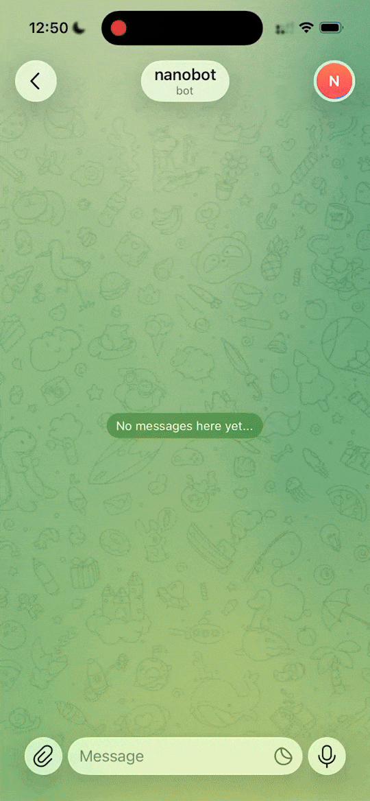
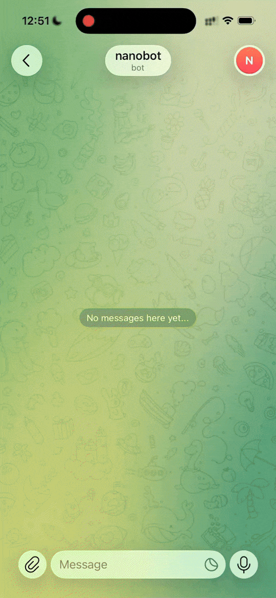
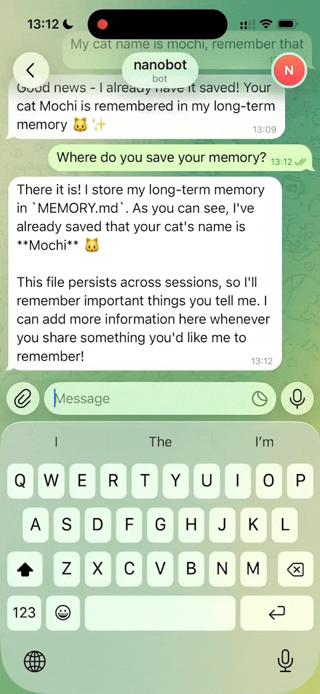

<div align="center">
  
  <h1>nanobot: Ultra-Lightweight Personal AI Assistant</h1>
  <p>
    
    
    <a href="https://inematds.github.io/nanobot/"></a>
  </p>
</div>

🐈 **nanobot** is an **ultra-lightweight** personal AI assistant — fork from the [original project (HKUDS/nanobot)](https://github.com/HKUDS/nanobot)

⚡️ Delivers core agent functionality in just **~4,000** lines of code.

> **📖 [Documentação completa no GitHub Pages](https://inematds.github.io/nanobot/)** — Arquitetura, Guia de Instalação, Docker e Referência Técnica

## Key Features of nanobot:

🪶 **Ultra-Lightweight**: Just ~4,000 lines of core agent code — 99% smaller than Clawdbot.

🔬 **Research-Ready**: Clean, readable code that's easy to understand, modify, and extend for research.

⚡️ **Lightning Fast**: Minimal footprint means faster startup, lower resource usage, and quicker iterations.

💎 **Easy-to-Use**: One-click to deploy and you're ready to go.

## 🆕 O que este fork inclui

Adições e melhorias feitas neste repositório sobre o projeto original (~4.400 linhas de documentação adicionadas):

| Adição | Detalhes | Linhas |
|--------|----------|--------|
| **README em PT-BR** | Instalação, Quick Start, Troubleshooting, Skills, Docker, tudo em português | 1.068 |
| **GitHub Pages** | [Arquitetura](https://inematds.github.io/nanobot/) · [Instalação](https://inematds.github.io/nanobot/instalacao.html) · [Docker](https://inematds.github.io/nanobot/docker.html) | 2.858 |
| **Guias Markdown** | `doc/GUIA_INSTALACAO.md` + `doc/GUIA_DOCKER.md` para leigos | 520 |
| **Skill Remotion** | 35 regras + 3 exemplos TSX do [remotion-dev](https://github.com/remotion-dev/remotion) e [inematds/remotion-skills](https://github.com/inematds/remotion-skills) | — |
| **Scripts auxiliares** | `start.sh` (ativa venv), `help.sh` (guia rápido), `diagnose.py` (diagnóstico) | — |
| **Aliases .bashrc** | `nb` (ativa ambiente), `nbhelp` (guia rápido) | — |

## 🏗️ Architecture

<p align="center">
  
</p>

## ✨ Features

<table align="center">
  <tr align="center">
    <th><p align="center">📈 24/7 Real-Time Market Analysis</p></th>
    <th><p align="center">🚀 Full-Stack Software Engineer</p></th>
    <th><p align="center">📅 Smart Daily Routine Manager</p></th>
    <th><p align="center">📚 Personal Knowledge Assistant</p></th>
  </tr>
  <tr>
    <td align="center"><p align="center"></p></td>
    <td align="center"><p align="center"></p></td>
    <td align="center"><p align="center"></p></td>
    <td align="center"><p align="center"></p></td>
  </tr>
  <tr>
    <td align="center">Discovery • Insights • Trends</td>
    <td align="center">Develop • Deploy • Scale</td>
    <td align="center">Schedule • Automate • Organize</td>
    <td align="center">Learn • Memory • Reasoning</td>
  </tr>
</table>

## 📦 Install

Escolha entre **VPS direto** ou **Docker**. Ambos usam o mesmo repositório.

### Opção A: VPS Direto (recomendado)

**1. Atualizar o sistema e instalar ferramentas:**

```bash
apt update && apt upgrade -y
apt install -y python3 python3-venv python3-pip git
```

- `python3` — linguagem que o nanobot usa
- `python3-venv` — permite criar ambientes virtuais (o Ubuntu 24.04 não traz por padrão)
- `git` — para baixar o código do GitHub

**2. Clonar o repositório:**

```bash
cd /root
git clone https://github.com/inematds/nanobot.git
cd nanobot
```

**3. Criar o ambiente virtual (venv):**

```bash
python3 -m venv venv
```

O venv é uma cópia isolada do Python. Ele funciona como uma "caixa" onde as dependências
do nanobot ficam separadas do sistema. Sem isso, instalar pacotes pode quebrar o Ubuntu.

**4. Ativar o venv:**

```bash
source venv/bin/activate
```

O prompt muda para `(venv) root@servidor:~/nanobot#` indicando que está ativo.

> [!IMPORTANT]
> **O que é o `source`?** Quando você roda um script normal (`./start.sh`), ele abre
> um terminal temporário, executa lá dentro, e fecha — as mudanças morrem junto.
> Com `source`, os comandos rodam **no seu terminal atual**, então o venv fica ativo pra você usar.
> Toda vez que abrir um novo terminal SSH, precisa rodar `source` de novo (ou usar o atalho `nb`).

**5. Instalar o nanobot e dependências:**

```bash
pip install -e .
```

O `pip` lê o `pyproject.toml` e instala tudo que o nanobot precisa (~50 pacotes) dentro do venv.
O `-e` significa "editável" — se fizer `git pull` depois, as mudanças valem sem reinstalar.

**Resumo em uma linha:**

```bash
apt install -y python3 python3-venv git && cd /root && git clone https://github.com/inematds/nanobot.git && cd nanobot && python3 -m venv venv && source venv/bin/activate && pip install -e .
```

### Opção B: Docker

Com Docker, **você não precisa de venv, pip, nem ativar ambiente**. O container faz tudo isolado.

```bash
# 1. Clonar o repositório
git clone https://github.com/inematds/nanobot.git
cd nanobot

# 2. Construir e subir (leva 2-3 minutos na primeira vez)
docker compose up -d
```

O que acontece por dentro:

| Etapa | O que o Docker faz sozinho |
|-------|---------------------------|
| Baixa Python 3.12 | Imagem base já vem com Python |
| Instala Node.js 20 | Para a bridge do WhatsApp |
| Instala dependências | `uv pip install .` (todas as ~50 bibliotecas) |
| Compila bridge | `npm install && npm run build` |
| Cria estrutura | Diretórios de config, workspace, sessions |
| Inicia o gateway | Roda `nanobot gateway` automaticamente |

> [!TIP]
> **Vantagem do Docker:** o container reinicia sozinho se o servidor reiniciar
> (`restart: unless-stopped`). Não precisa de systemd nem de venv.

> [!NOTE]
> Depois de construir a imagem, **pode apagar o diretório clonado** se quiser.
> O código fica dentro da imagem Docker e os dados ficam no volume `nanobot-data`.
> Porém, se manter o diretório, fica mais fácil atualizar com `git pull && docker compose up -d --build`.

**Comandos do dia a dia com Docker:**

| O que quer fazer | Comando |
|------------------|---------|
| Iniciar | `docker compose up -d` |
| Parar | `docker compose down` |
| Reiniciar | `docker compose restart` |
| Ver logs ao vivo | `docker compose logs -f` |
| Ver status | `docker compose exec nanobot nanobot status` |
| Entrar no container | `docker compose exec nanobot bash` |
| Mandar mensagem | `docker compose exec nanobot nanobot agent -m "Olá"` |
| Atualizar código | `git pull && docker compose up -d --build` |

> Guia completo com Docker: [`doc/GUIA_DOCKER.md`](doc/GUIA_DOCKER.md)

### Outras formas de instalar

```bash
# Via uv (rápido)
uv tool install nanobot-ai

# Via PyPI
pip install nanobot-ai
```

## 🚀 Quick Start

### Passo 1: Inicializar

```bash
# VPS direto (com venv ativo)
nanobot onboard

# Docker
docker compose exec nanobot nanobot onboard
```

Isso cria a pasta `~/.nanobot/` com a configuração padrão e o workspace do agente.

### Passo 2: Configurar atalhos (opcional, recomendado)

```bash
echo '' >> ~/.bashrc
echo '# Nanobot - atalhos' >> ~/.bashrc
echo 'alias nb="cd /root/nanobot && source venv/bin/activate"' >> ~/.bashrc
echo 'alias nbhelp="cd /root/nanobot && bash help.sh"' >> ~/.bashrc
source ~/.bashrc
```

Isso cria dois atalhos que funcionam toda vez que você entrar via SSH:

| Atalho | O que faz |
|--------|-----------|
| `nb` | Ativa o ambiente do nanobot (mesmo que `cd /root/nanobot && source venv/bin/activate`) |
| `nbhelp` | Mostra um guia rápido com todos os comandos |

> [!TIP]
> **O que é o `.bashrc`?** É um arquivo que o Linux lê automaticamente toda vez que
> você abre um terminal ou entra via SSH. É como uma "lista de preparação automática".
>
> **O que é um `alias`?** É um apelido para um comando longo. Em vez de digitar
> `cd /root/nanobot && source venv/bin/activate`, você digita só `nb`.
> Funciona como o contato do celular — em vez de decorar o número, salva com um nome.

Também existem dois scripts na raiz do projeto:

| Script | Como usar | O que faz |
|--------|-----------|-----------|
| `start.sh` | `source start.sh` | Ativa o venv (precisa do `source`) |
| `help.sh` | `bash help.sh` | Mostra guia rápido com todos os comandos |

### Passo 3: Configurar a API Key

> [!CAUTION]
> **Cuidado com os diretórios!** O nanobot usa **dois diretórios diferentes**:
>
> | Diretório | O que é | Exemplo |
> |-----------|---------|---------|
> | `~/nanobot/` | **Código fonte** (repositório git) | `~/nanobot/nanobot/`, `~/nanobot/README.md` |
> | `~/.nanobot/` | **Dados e configuração** (pasta oculta) | `~/.nanobot/config.json`, `~/.nanobot/workspace/` |
>
> O arquivo de configuração fica em **`~/.nanobot/config.json`** (com ponto!).
> Se você editar `~/nanobot/config.json` (sem ponto), o nanobot **não vai encontrar**.

```bash
# Criar o diretório de dados (se não existir)
mkdir -p ~/.nanobot

# Copiar o exemplo como ponto de partida
cp ~/nanobot/config.example.json ~/.nanobot/config.json

# Editar e colocar sua API key
nano ~/.nanobot/config.json
```

> [!TIP]
> **Onde conseguir API keys:**
> - [OpenRouter](https://openrouter.ai/keys) — acesso a todos os modelos (recomendado)
> - [Anthropic](https://console.anthropic.com) — Claude direto
> - [OpenAI](https://platform.openai.com) — GPT direto
> - [DeepSeek](https://platform.deepseek.com) — DeepSeek direto
> - [Brave Search](https://brave.com/search/api/) — busca web (opcional)

**Exemplo mínimo com OpenRouter + Telegram** (recomendado):
```json
{
  "providers": {
    "openrouter": {
      "apiKey": "sk-or-v1-COLE_SUA_CHAVE_AQUI"
    }
  },
  "agents": {
    "defaults": {
      "model": "qwen/qwen3-coder-next"
    }
  },
  "channels": {
    "telegram": {
      "enabled": true,
      "token": "SEU_TOKEN_DO_BOTFATHER",
      "allowFrom": ["SEU_ID_NUMERICO"]
    }
  }
}
```

**Exemplo mínimo com Anthropic direto + Telegram:**
```json
{
  "providers": {
    "anthropic": {
      "apiKey": "sk-ant-COLE_SUA_CHAVE_AQUI"
    }
  },
  "agents": {
    "defaults": {
      "model": "anthropic/claude-sonnet-4-5-20250929"
    }
  },
  "channels": {
    "telegram": {
      "enabled": true,
      "token": "SEU_TOKEN_DO_BOTFATHER",
      "allowFrom": ["SEU_ID_NUMERICO"]
    }
  }
}
```

> [!WARNING]
> **O nome do modelo depende do provider!** Cada provider usa seu próprio formato:
>
> | Provider | Formato do modelo | Exemplo |
> |----------|-------------------|---------|
> | OpenRouter | Slug do OpenRouter | `anthropic/claude-sonnet-4.5` |
> | Anthropic direto | ID oficial Anthropic | `anthropic/claude-sonnet-4-5-20250929` |
> | OpenAI | ID oficial OpenAI | `openai/gpt-4o` |
> | DeepSeek | ID DeepSeek | `deepseek/deepseek-chat` |
>
> Consulte a página do modelo no seu provider para o nome exato.

> [!IMPORTANT]
> Depois de salvar, proteja o arquivo: `chmod 600 ~/.nanobot/config.json`

**Verificar se o config foi carregado corretamente:**
```bash
nanobot status
```
Todos os providers com API key devem aparecer com **✓**. Se aparecer "not set", verifique se editou o arquivo correto (`~/.nanobot/config.json`).

### Passo 4: Testar

```bash
nanobot agent -m "What is 2+2?"
```

### Passo 5: Rodar o Gateway (modo servidor)

```bash
# VPS direto (roda em foreground, Ctrl+C para parar)
nanobot gateway

# Docker (já está rodando se usou docker compose up -d)
docker compose logs -f nanobot
```

#### Autostart com systemd (recomendado para VPS)

Crie o serviço para que o nanobot inicie automaticamente no boot e reinicie se crashar:

```bash
cat > /etc/systemd/system/nanobot.service << 'EOF'
[Unit]
Description=nanobot AI Assistant Gateway
After=network-online.target
Wants=network-online.target

[Service]
Type=simple
User=root
WorkingDirectory=/root/nanobot
ExecStart=/root/nanobot/venv/bin/python -m nanobot gateway
Restart=on-failure
RestartSec=5
StandardOutput=append:/root/.nanobot/gateway.log
StandardError=append:/root/.nanobot/gateway.log

[Install]
WantedBy=multi-user.target
EOF

systemctl daemon-reload
systemctl enable nanobot.service
systemctl start nanobot.service
```

> [!TIP]
> Com `Restart=on-failure`, o systemd reinicia o nanobot automaticamente se o processo crashar
> (ex: erro de rede, OOM, etc.). Com `enable`, ele inicia sozinho no boot da VPS.

**Comandos do systemd:**

| O que quer fazer | Comando |
|------------------|---------|
| Iniciar | `systemctl start nanobot` |
| Parar | `systemctl stop nanobot` |
| Reiniciar | `systemctl restart nanobot` |
| Ver status | `systemctl status nanobot` |
| Ver log ao vivo | `journalctl -u nanobot -f` ou `tail -f ~/.nanobot/gateway.log` |
| Desabilitar autostart | `systemctl disable nanobot` |

### Passo 6: Verificar segurança

```bash
nanobot security-check
```

That's it! You have a working AI assistant.

## 🔧 Uso no Dia a Dia

Toda vez que entrar via SSH, primeiro ative o ambiente:

```bash
# Opção 1: atalho (se configurou no passo 2)
nb

# Opção 2: usando o script
cd /root/nanobot
source start.sh

# Opção 3: comando completo
cd /root/nanobot && source venv/bin/activate
```

### Comandos rápidos

| O que quer fazer          | Comando (systemd) | Comando (manual) |
|---------------------------|-------------------|------------------|
| Ver configuração          | `nanobot status` | `nanobot status` |
| Ver se está rodando       | `systemctl status nanobot` | `ps aux \| grep 'nanobot gateway'` |
| Iniciar                   | `systemctl start nanobot` | `nanobot gateway` |
| Parar                     | `systemctl stop nanobot` | `pkill -f 'nanobot gateway'` |
| Reiniciar                 | `systemctl restart nanobot` | `pkill -f 'nanobot gateway' && nanobot gateway` |
| Ver log ao vivo           | `journalctl -u nanobot -f` | `tail -f ~/.nanobot/gateway.log` |
| Ver guia rápido           | `bash help.sh` | `bash help.sh` |

### Atualizar o código

```bash
nb
git pull && pip install -e .
systemctl restart nanobot
```

## ❓ Troubleshooting

<details>
<summary><b>"Error: No API key configured"</b></summary>

**Causa mais comum:** config no diretório errado.

```bash
# Verificar se o config está no lugar certo
cat ~/.nanobot/config.json

# Se mostrar keys vazias ou arquivo não encontrado:
cp ~/nanobot/config.example.json ~/.nanobot/config.json
nano ~/.nanobot/config.json   # Adicionar sua API key
```

Lembre: `~/.nanobot/` (com ponto) ≠ `~/nanobot/` (sem ponto).

</details>

<details>
<summary><b>"pip: command not found" ou erro ao instalar</b></summary>

Use ambiente virtual (venv) em vez de pip global:

```bash
apt update && apt install -y python3 python3-venv
python3 -m venv venv
source venv/bin/activate
pip install -e .
```

</details>

<details>
<summary><b>nanobot status mostra providers "not set" mesmo com key configurada</b></summary>

1. Verifique se editou `~/.nanobot/config.json` (com ponto)
2. Verifique se o JSON é válido: `python3 -c "import json; json.load(open('/root/.nanobot/config.json')); print('OK')"`
3. Verifique se a key está no campo correto (ex: `providers.openrouter.apiKey`)
4. Rode `python3 diagnose.py` na pasta do projeto para diagnóstico detalhado

</details>

<details>
<summary><b>Modelo não encontrado / erro de modelo</b></summary>

Cada provider usa nomes diferentes. Verifique o nome exato na página do provider:

- **OpenRouter:** vá em [openrouter.ai/models](https://openrouter.ai/models), copie o ID do modelo (ex: `anthropic/claude-sonnet-4.5`)
- **Anthropic direto:** use o ID oficial (ex: `anthropic/claude-sonnet-4-5-20250929`)
- **OpenAI:** use o ID oficial (ex: `openai/gpt-4o`)

</details>

<details>
<summary><b>Git clone dá "Permission denied"</b></summary>

O repositório é público. Use HTTPS (não SSH):

```bash
git clone https://github.com/inematds/nanobot.git
```

SSH só funciona se você tiver uma chave SSH configurada no GitHub.

</details>

## 🖥️ Local Models (vLLM)

Run nanobot with your own local models using vLLM or any OpenAI-compatible server.

**1. Start your vLLM server**

```bash
vllm serve meta-llama/Llama-3.1-8B-Instruct --port 8000
```

**2. Configure** (`~/.nanobot/config.json`)

```json
{
  "providers": {
    "vllm": {
      "apiKey": "dummy",
      "apiBase": "http://localhost:8000/v1"
    }
  },
  "agents": {
    "defaults": {
      "model": "meta-llama/Llama-3.1-8B-Instruct"
    }
  }
}
```

**3. Chat**

```bash
nanobot agent -m "Hello from my local LLM!"
```

> [!TIP]
> The `apiKey` can be any non-empty string for local servers that don't require authentication.

## 💬 Chat Apps

Talk to your nanobot through Telegram, Discord, WhatsApp, or Feishu — anytime, anywhere.

<p align="center">
  
</p>

| Channel | Setup |
|---------|-------|
| **Telegram** | Easy (just a token) |
| **Discord** | Easy (bot token + intents) |
| **WhatsApp** | Medium (scan QR) |
| **Feishu** | Medium (app credentials) |

<details>
<summary><b>Telegram</b> (Recommended)</summary>

**1. Criar o bot**
- Abra o Telegram e busque `@BotFather`
- Envie `/newbot` e siga as instruções (escolha nome e username)
- O BotFather vai te dar um **token** como: `123456789:ABCdefGHIjklMNOpqrsTUVwxyz`
- Copie esse token

**2. Descobrir seu User ID**
- Busque `@userinfobot` no Telegram
- Envie qualquer mensagem para ele
- Ele responde com seu **ID numérico** (ex: `987654321`)

**3. Configurar**

Edite `~/.nanobot/config.json` e adicione/atualize a seção `channels`:

```json
{
  "providers": {
    "openrouter": {
      "apiKey": "sk-or-v1-SUA_KEY"
    }
  },
  "agents": {
    "defaults": {
      "model": "anthropic/claude-sonnet-4.5"
    }
  },
  "channels": {
    "telegram": {
      "enabled": true,
      "token": "123456789:ABCdefGHIjklMNOpqrsTUVwxyz",
      "allowFrom": ["987654321"]
    }
  }
}
```

> [!WARNING]
> O `allowFrom` é **obrigatório** por segurança. Se deixar vazio `[]`, **ninguém** consegue usar o bot.
> Coloque seu User ID numérico como string entre aspas.

**4. Rodar**

```bash
nanobot gateway
```

O bot vai ficar online no Telegram. Envie uma mensagem para ele para testar.

</details>

<details>
<summary><b>Discord</b></summary>

**1. Create a bot**
- Go to https://discord.com/developers/applications
- Create an application → Bot → Add Bot
- Copy the bot token

**2. Enable intents**
- In the Bot settings, enable **MESSAGE CONTENT INTENT**
- (Optional) Enable **SERVER MEMBERS INTENT** if you plan to use allow lists based on member data

**3. Get your User ID**
- Discord Settings → Advanced → enable **Developer Mode**
- Right-click your avatar → **Copy User ID**

**4. Configure**

```json
{
  "channels": {
    "discord": {
      "enabled": true,
      "token": "YOUR_BOT_TOKEN",
      "allowFrom": ["YOUR_USER_ID"]
    }
  }
}
```

**5. Invite the bot**
- OAuth2 → URL Generator
- Scopes: `bot`
- Bot Permissions: `Send Messages`, `Read Message History`
- Open the generated invite URL and add the bot to your server

**6. Run**

```bash
nanobot gateway
```

</details>

<details>
<summary><b>WhatsApp</b></summary>

Requer **Node.js ≥18** instalado no servidor.

**1. Instalar Node.js (se não tiver)**

```bash
curl -fsSL https://deb.nodesource.com/setup_20.x | bash -
apt install -y nodejs
```

**2. Compilar a bridge do WhatsApp**

```bash
cd ~/nanobot/bridge
npm install && npm run build
cd ~/nanobot
```

**3. Vincular dispositivo**

```bash
nanobot channels login
```

Um QR code vai aparecer no terminal. No celular:
- Abra o WhatsApp → **Configurações** → **Dispositivos vinculados** → **Vincular dispositivo**
- Escaneie o QR code

**4. Configurar**

Edite `~/.nanobot/config.json` e adicione a seção WhatsApp:

```json
{
  "providers": {
    "openrouter": {
      "apiKey": "sk-or-v1-SUA_KEY"
    }
  },
  "agents": {
    "defaults": {
      "model": "anthropic/claude-sonnet-4.5"
    }
  },
  "channels": {
    "whatsapp": {
      "enabled": true,
      "allowFrom": ["+5511999998888"]
    }
  }
}
```

> [!WARNING]
> O `allowFrom` usa o número no formato internacional com `+` (ex: `+5511999998888`).
> Se deixar vazio `[]`, **ninguém** consegue usar o bot.

**5. Rodar** (dois terminais)

```bash
# Terminal 1 — manter a bridge rodando
nanobot channels login

# Terminal 2 — rodar o gateway
nanobot gateway
```

Envie uma mensagem para o número vinculado para testar.

</details>

<details>
<summary><b>Feishu (飞书)</b></summary>

Uses **WebSocket** long connection — no public IP required.

**1. Create a Feishu bot**
- Visit [Feishu Open Platform](https://open.feishu.cn/app)
- Create a new app → Enable **Bot** capability
- **Permissions**: Add `im:message` (send messages)
- **Events**: Add `im.message.receive_v1` (receive messages)
  - Select **Long Connection** mode (requires running nanobot first to establish connection)
- Get **App ID** and **App Secret** from "Credentials & Basic Info"
- Publish the app

**2. Configure**

```json
{
  "channels": {
    "feishu": {
      "enabled": true,
      "appId": "cli_xxx",
      "appSecret": "xxx",
      "encryptKey": "",
      "verificationToken": "",
      "allowFrom": []
    }
  }
}
```

> `encryptKey` and `verificationToken` are optional for Long Connection mode.
> `allowFrom`: Leave empty to allow all users, or add `["ou_xxx"]` to restrict access.

**3. Run**

```bash
nanobot gateway
```

> [!TIP]
> Feishu uses WebSocket to receive messages — no webhook or public IP needed!

</details>

<details>
<summary><b>DingTalk (钉钉)</b></summary>

Uses **Stream Mode** — no public IP required.

**1. Create a DingTalk bot**
- Visit [DingTalk Open Platform](https://open-dev.dingtalk.com/)
- Create a new app -> Add **Robot** capability
- **Configuration**:
  - Toggle **Stream Mode** ON
- **Permissions**: Add necessary permissions for sending messages
- Get **AppKey** (Client ID) and **AppSecret** (Client Secret) from "Credentials"
- Publish the app

**2. Configure**

```json
{
  "channels": {
    "dingtalk": {
      "enabled": true,
      "clientId": "YOUR_APP_KEY",
      "clientSecret": "YOUR_APP_SECRET",
      "allowFrom": []
    }
  }
}
```

> `allowFrom`: Leave empty to allow all users, or add `["staffId"]` to restrict access.

**3. Run**

```bash
nanobot gateway
```

</details>

## ⚙️ Configuration

Config file: `~/.nanobot/config.json`

### Providers

> [!NOTE]
> Groq provides free voice transcription via Whisper. If configured, Telegram voice messages will be automatically transcribed.

| Provider | Purpose | Get API Key |
|----------|---------|-------------|
| `openrouter` | LLM (recommended, access to all models) | [openrouter.ai](https://openrouter.ai) |
| `anthropic` | LLM (Claude direct) | [console.anthropic.com](https://console.anthropic.com) |
| `openai` | LLM (GPT direct) | [platform.openai.com](https://platform.openai.com) |
| `deepseek` | LLM (DeepSeek direct) | [platform.deepseek.com](https://platform.deepseek.com) |
| `groq` | LLM + **Voice transcription** (Whisper) | [console.groq.com](https://console.groq.com) |
| `gemini` | LLM (Gemini direct) | [aistudio.google.com](https://aistudio.google.com) |
| `aihubmix` | LLM (API gateway, access to all models) | [aihubmix.com](https://aihubmix.com) |
| `dashscope` | LLM (Qwen) | [dashscope.console.aliyun.com](https://dashscope.console.aliyun.com) |
| `moonshot` | LLM (Moonshot/Kimi) | [platform.moonshot.cn](https://platform.moonshot.cn) |
| `zhipu` | LLM (Zhipu GLM) | [open.bigmodel.cn](https://open.bigmodel.cn) |
| `vllm` | LLM (local, any OpenAI-compatible server) | — |

<details>
<summary><b>Adding a New Provider (Developer Guide)</b></summary>

nanobot uses a **Provider Registry** (`nanobot/providers/registry.py`) as the single source of truth.
Adding a new provider only takes **2 steps** — no if-elif chains to touch.

**Step 1.** Add a `ProviderSpec` entry to `PROVIDERS` in `nanobot/providers/registry.py`:

```python
ProviderSpec(
    name="myprovider",                   # config field name
    keywords=("myprovider", "mymodel"),  # model-name keywords for auto-matching
    env_key="MYPROVIDER_API_KEY",        # env var for LiteLLM
    display_name="My Provider",          # shown in `nanobot status`
    litellm_prefix="myprovider",         # auto-prefix: model → myprovider/model
    skip_prefixes=("myprovider/",),      # don't double-prefix
)
```

**Step 2.** Add a field to `ProvidersConfig` in `nanobot/config/schema.py`:

```python
class ProvidersConfig(BaseModel):
    ...
    myprovider: ProviderConfig = ProviderConfig()
```

That's it! Environment variables, model prefixing, config matching, and `nanobot status` display will all work automatically.

**Common `ProviderSpec` options:**

| Field | Description | Example |
|-------|-------------|---------|
| `litellm_prefix` | Auto-prefix model names for LiteLLM | `"dashscope"` → `dashscope/qwen-max` |
| `skip_prefixes` | Don't prefix if model already starts with these | `("dashscope/", "openrouter/")` |
| `env_extras` | Additional env vars to set | `(("ZHIPUAI_API_KEY", "{api_key}"),)` |
| `model_overrides` | Per-model parameter overrides | `(("kimi-k2.5", {"temperature": 1.0}),)` |
| `is_gateway` | Can route any model (like OpenRouter) | `True` |
| `detect_by_key_prefix` | Detect gateway by API key prefix | `"sk-or-"` |
| `detect_by_base_keyword` | Detect gateway by API base URL | `"openrouter"` |
| `strip_model_prefix` | Strip existing prefix before re-prefixing | `True` (for AiHubMix) |

</details>


### Security

> [!IMPORTANT]
> **Breaking changes:** `restrictToWorkspace` agora é `true` por padrão, `allowFrom` vazio agora **nega todos**, e o gateway escuta em `127.0.0.1`. Veja [SECURITY.md](./SECURITY.md) para detalhes.

| Option | Default | Description |
|--------|---------|-------------|
| `tools.restrictToWorkspace` | `true` | Restringe todos os tools ao diretório workspace. Previne path traversal. |
| `channels.*.allowFrom` | `[]` (deny all) | Lista de IDs permitidos. Vazio = nega todos (fail-secure). Adicione IDs para liberar. |
| `gateway.host` | `127.0.0.1` | Endereço de bind. Use reverse proxy para acesso remoto. |

```bash
# Verificar configuração de segurança
nanobot security-check
```


## 🧩 Skills (Habilidades do Agente)

O nanobot vem com **skills** — pacotes de conhecimento que o agente carrega conforme necessário.
Cada skill é uma pasta com um `SKILL.md` (descrição + regras) e opcionalmente scripts e exemplos de código.

### Skills incluídos

| Skill | Descrição | Requer |
|-------|-----------|--------|
| **remotion** | Criação de vídeos em React — animações, 3D, áudio, charts, captions, transitions. 35 regras + 3 exemplos de código | `npx` |
| **agent-browser** | Automação de browser — navegar sites, preencher forms, screenshots, extrair dados | `agent-browser` |
| **github** | Interação com GitHub via `gh` CLI — issues, PRs, CI runs | `gh` |
| **summarize** | Resumir/transcrever URLs, podcasts, vídeos do YouTube | `summarize` |
| **weather** | Clima e previsão do tempo (sem API key) | — |
| **tmux** | Controle remoto de sessões tmux | `tmux` |
| **cron** | Agendar lembretes e tarefas recorrentes | — |
| **skill-creator** | Criar ou atualizar skills do agente | — |

### Remotion Skill (destaque)

O skill de **Remotion** é o mais completo, adaptado do [repositório oficial](https://github.com/remotion-dev/remotion).
Inclui:

- **35 regras** de referência cobrindo: animações, composições, áudio, 3D (Three.js), charts, captions/legendas, GIFs, Lottie, mapas (Mapbox), fontes, timing/easing, transições, FFmpeg, TailwindCSS e mais
- **3 exemplos de código** prontos em TypeScript/React:
  - `charts-bar-chart.tsx` — gráfico de barras animado com spring physics
  - `text-animations-typewriter.tsx` — efeito typewriter com cursor piscando
  - `text-animations-word-highlight.tsx` — destaque de palavra com animação wipe

```
nanobot/skills/remotion/
├── SKILL.md                              ← Índice e referência rápida
├── rules/                                ← 35 regras detalhadas
│   ├── animations.md, timing.md          #   Animações e interpolação
│   ├── audio.md, audio-visualization.md  #   Áudio e visualização
│   ├── 3d.md, charts.md, lottie.md       #   Conteúdo visual
│   ├── subtitles.md, display-captions.md #   Legendas
│   ├── transitions.md, sequencing.md     #   Transições e sequenciamento
│   ├── ffmpeg.md, videos.md, images.md   #   Mídia
│   └── ...                               #   E mais 22 regras
└── rules/assets/                         ← Exemplos de código (.tsx)
    ├── charts-bar-chart.tsx
    ├── text-animations-typewriter.tsx
    └── text-animations-word-highlight.tsx
```

> Fonte: [github.com/remotion-dev/remotion](https://github.com/remotion-dev/remotion) (adaptado para formato nanobot)
> Fork com exemplos: [github.com/inematds/remotion-skills](https://github.com/inematds/remotion-skills)

### Como os skills funcionam

1. O agente lê o `SKILL.md` para entender quando usar o skill
2. Conforme a conversa, carrega regras específicas (ex: `rules/audio.md` quando o assunto é áudio)
3. Skills com `requires` verificam se as ferramentas necessárias estão instaladas
4. Para criar seus próprios skills, use o skill `skill-creator`

## CLI Reference

| Command | Description |
|---------|-------------|
| `nanobot onboard` | Initialize config & workspace |
| `nanobot agent -m "..."` | Chat with the agent |
| `nanobot agent` | Interactive chat mode |
| `nanobot gateway` | Start the gateway |
| `nanobot status` | Show status |
| `nanobot channels login` | Link WhatsApp (scan QR) |
| `nanobot channels status` | Show channel status |
| `nanobot security-check` | Verify security configuration |

<details>
<summary><b>Scheduled Tasks (Cron)</b></summary>

```bash
# Add a job
nanobot cron add --name "daily" --message "Good morning!" --cron "0 9 * * *"
nanobot cron add --name "hourly" --message "Check status" --every 3600

# List jobs
nanobot cron list

# Remove a job
nanobot cron remove <job_id>
```

</details>

## 🐳 Docker

O `docker-compose.yml` inclui volume persistente, limites de recursos (2GB RAM, 2 CPUs),
e roda como usuário non-root. Guia completo: [`doc/GUIA_DOCKER.md`](doc/GUIA_DOCKER.md)

**Setup inicial:**

```bash
# 1. Subir (build + run em background)
docker compose up -d

# 2. Inicializar config (primeira vez)
docker compose exec nanobot nanobot onboard

# 3. Colocar sua configuração
cat > /tmp/nanobot-config.json << 'EOF'
{
  "providers": {
    "openrouter": { "apiKey": "sk-or-v1-SUA_CHAVE" }
  },
  "agents": {
    "defaults": { "model": "qwen/qwen3-coder-next" }
  },
  "channels": {
    "telegram": {
      "enabled": true,
      "token": "SEU_TOKEN_DO_BOTFATHER",
      "allowFrom": ["SEU_ID_NUMERICO"]
    }
  }
}
EOF
docker compose cp /tmp/nanobot-config.json nanobot:/home/nanobot/.nanobot/config.json

# 4. Reiniciar pra pegar a nova config
docker compose restart
```

**Uso no dia a dia:**

| O que quer fazer | Comando |
|------------------|---------|
| Iniciar | `docker compose up -d` |
| Parar | `docker compose down` |
| Reiniciar | `docker compose restart` |
| Ver logs ao vivo | `docker compose logs -f` |
| Ver status | `docker compose exec nanobot nanobot status` |
| Entrar no container | `docker compose exec nanobot bash` |
| Atualizar código | `git pull && docker compose up -d --build` |

> [!NOTE]
> Depois de construir, pode apagar o diretório clonado se quiser.
> O código fica na imagem Docker e os dados no volume `nanobot-data`.
> Mas mantendo o diretório, fica mais fácil atualizar.

**Sem docker compose** (manual):

```bash
docker build -t nanobot .
docker run -v ~/.nanobot:/home/nanobot/.nanobot -p 127.0.0.1:18790:18790 --restart unless-stopped -d nanobot gateway
```

**Docker vs VPS direto:**

| | VPS Direto | Docker |
|--|-----------|--------|
| Precisa de venv? | Sim | Não |
| Precisa ativar ambiente? | Sim (`source`) | Não |
| Reinicia sozinho? | Sim (com systemd) | Sim |
| Limites de recurso | Sem limite | 2GB RAM, 2 CPUs |
| Segurança | Root direto | Usuário sem privilégios |

## 📁 Project Structure

```
/root/
├── nanobot/                    ← CÓDIGO (git clone)
│   ├── nanobot/                ← Código-fonte do bot
│   │   ├── agent/              #   🧠 Core agent logic (loop, context, memory, tools)
│   │   ├── channels/           #   📱 Telegram, Discord, WhatsApp, Feishu, DingTalk
│   │   ├── providers/          #   🤖 LLM providers (OpenRouter, Anthropic, etc.)
│   │   ├── skills/             #   🧩 Skills do agente
│   │   │   ├── remotion/       #     🎬 Vídeo em React (35 regras + exemplos)
│   │   │   ├── agent-browser/  #     🌐 Automação de browser
│   │   │   ├── github/         #     🐙 GitHub CLI
│   │   │   ├── summarize/      #     📝 Resumir URLs e vídeos
│   │   │   ├── weather/        #     🌤️ Clima
│   │   │   ├── tmux/           #     🧵 Sessões tmux
│   │   │   ├── cron/           #     ⏰ Tarefas agendadas
│   │   │   └── skill-creator/  #     🔧 Criar novos skills
│   │   ├── bus/                #   🚌 Message routing
│   │   ├── cron/               #   ⏰ Scheduled tasks
│   │   ├── heartbeat/          #   💓 Proactive wake-up
│   │   ├── session/            #   💬 Conversation sessions
│   │   ├── config/             #   ⚙️ Configuration
│   │   └── cli/                #   🖥️ Commands
│   ├── bridge/                 ← Bridge WhatsApp (Node.js)
│   ├── doc/                    ← Documentação
│   │   ├── GUIA_INSTALACAO.md  #   Guia completo para leigos
│   │   └── GUIA_DOCKER.md      #   Guia completo Docker
│   ├── venv/                   ← Ambiente virtual Python (criado na instalação)
│   ├── start.sh                ← Script: ativa o venv (usar com source)
│   ├── help.sh                 ← Script: mostra guia rápido de comandos
│   ├── pyproject.toml          ← Dependências do projeto
│   └── config.example.json     ← Exemplo de configuração
│
└── .nanobot/                   ← DADOS DE RUNTIME (criado pelo onboard)
    ├── config.json             ← Configuração real (chaves, modelo, canais)
    ├── gateway.log             ← Log do servidor
    ├── sessions/               ← Histórico de conversas
    ├── cron/                   ← Tarefas agendadas
    └── workspace/              ← Personalidade do agente (SOUL.md, AGENTS.md)
```

> [!CAUTION]
> Existem **DOIS** diretórios parecidos. O nanobot lê a configuração de `~/.nanobot/config.json`
> (com ponto). O arquivo `~/nanobot/config.example.json` (sem ponto) é apenas um exemplo.

## 🔗 Créditos

Este projeto é um fork de [HKUDS/nanobot](https://github.com/HKUDS/nanobot), com adições de documentação, skills e ferramentas auxiliares.

<p align="center">
  <sub>nanobot is for educational, research, and technical exchange purposes only</sub>
</p>

---

Projeto adaptado da comunidade INEMA TDS - Marca Arckhe